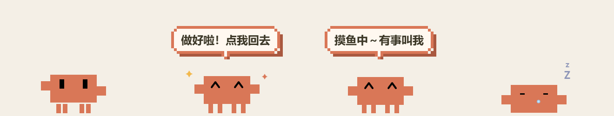

# Clawd Pet 🦀

一只浮在所有窗口最上层的 Clawd 像素小宠物，跟着 Claude Code 的状态动起来。
你去刷网页、看视频的时候，Claude 一做完，它就会蹦起来提醒你。



## 它会做什么

| 状态 | 样子 |
| --- | --- |
| **干活中** | 上下晃、甩手、踩小碎步，头上冒一滴汗 |
| **做好啦** | ^ ^ 笑眼蹦三下，冒小星星，弹出像素对话框「做好啦！点我回去」，几秒后自己消失 |
| **闲着** | 偶尔左右张望、扭一扭 |
| **睡觉** | 5 分钟没动静就睡着：脚缩起来趴下、鼻涕泡一鼓一鼓、飘 z z Z |
| **鼠标放上去** | 一直显示当前状态的文字（睡着时是「呼噜…zzZ」） |

- **单击**：回到 Claude 窗口（睡着时是把它叫醒）
- **拖动**：随便挪位置
- **右键**：先藏起来，下次 Claude 干活时会自己回来

## 安装（Windows）

需要 Windows 10/11 和 Claude Code（桌面版或命令行都行）。

```powershell
git clone https://github.com/sovven/clawd-pet.git
cd clawd-pet
powershell -ExecutionPolicy Bypass -File .\install.ps1
```

装完新开一个 Claude Code 会话就生效。安装脚本会：

1. 把 `clawd.ps1`、`mood.ps1` 复制到 `~/.claude/clawd-pet/`
2. 在 `~/.claude/settings.json` 里加 3 个 hook（`SessionStart` / `UserPromptSubmit` / `Stop`），原来的设置会备份成 `settings.json.bak-clawd`

## 卸载

```powershell
powershell -ExecutionPolicy Bypass -File .\uninstall.ps1
```

## 自己改

- 睡觉时间：`clawd.ps1` 第一行的 `-SleepAfter`（秒，默认 300）
- 气泡文字：`mood.ps1` 里的 `$says`
- 大小：`clawd.ps1` 里的 `$U`（一个像素点的大小，默认 5）

## 原理

Claude Code 的 hook 在你发消息、Claude 回完话时调用 `mood.ps1`，它把状态写进 `state.txt`；
`clawd.ps1` 是一个透明、置顶的 WPF 小窗口，每隔一会儿读一次这个文件，换动作。

---

粉丝自制，与 Anthropic 无关。Clawd 形象归 Anthropic 所有。
